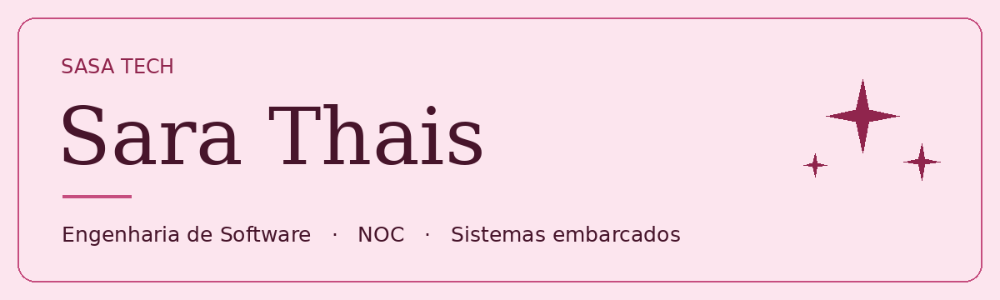

Sou estudante de Engenharia de Software na UniGoiás e analista de NOC. No trabalho, atuo com monitoramento de ambientes e atendimento a incidentes. Nos meus projetos, exploro desenvolvimento backend, comunicação em rede e sistemas embarcados.

## Projetos em destaque

### [Coflume](https://github.com/sarathais-tech/coflume)

Cofre educacional que desenvolvi com ESP32-S3 e apresentei na InovaTech 2026. No Quiz, a Guardiã IA roda na placa e ajuda a adaptar a dificuldade das perguntas durante a partida.

[Experimente a Guardiã IA sem o cofre](https://github.com/sarathais-tech/coflume#experimente-a-guardi%C3%A3-ia)

### Java e redes

| Projeto | O que desenvolvi |
| --- | --- |
| [Incident Support Chat](https://github.com/sarathais-tech/incident-support-chat-java) | Aplicação cliente-servidor em Java para simular atendimento a incidentes, com sockets TCP e chat criptografado. |
| [Chat TCP/UDP](https://github.com/sarathais-tech/chat-tcp-udp) | Demonstração em Spring Boot com chat por WebSockets e testes de latência UDP com perda de pacotes simulada. |

## Tecnologias

- **Backend e dados** · Python, FastAPI, Java e PostgreSQL
- **Monitoramento e suporte** · Zabbix, Grafana e GLPI
- **Sistemas embarcados** · ESP32-S3, Arduino e C++
